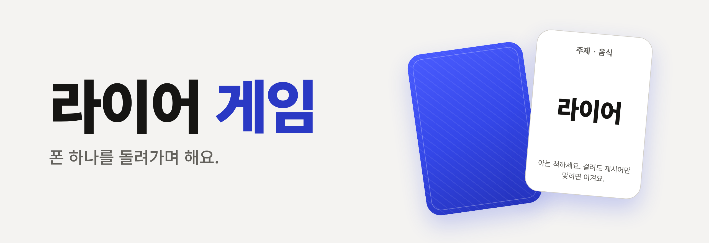
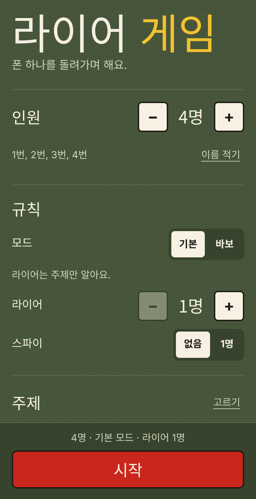
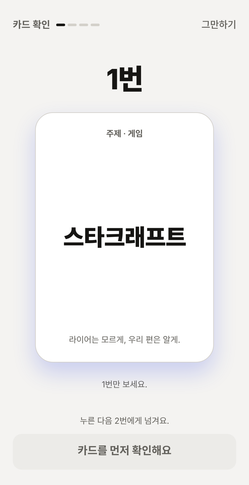
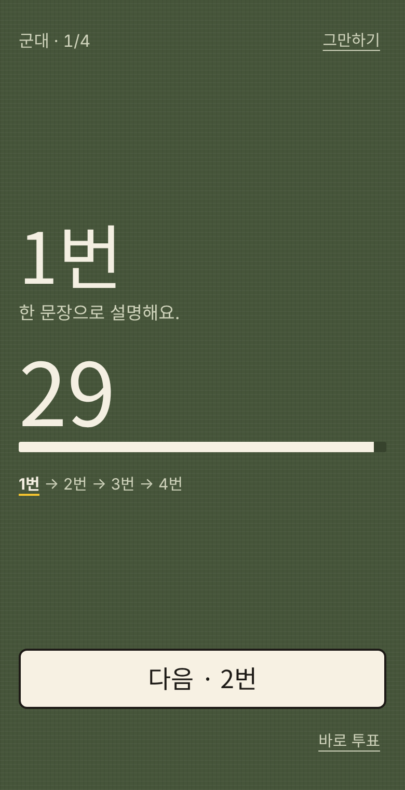
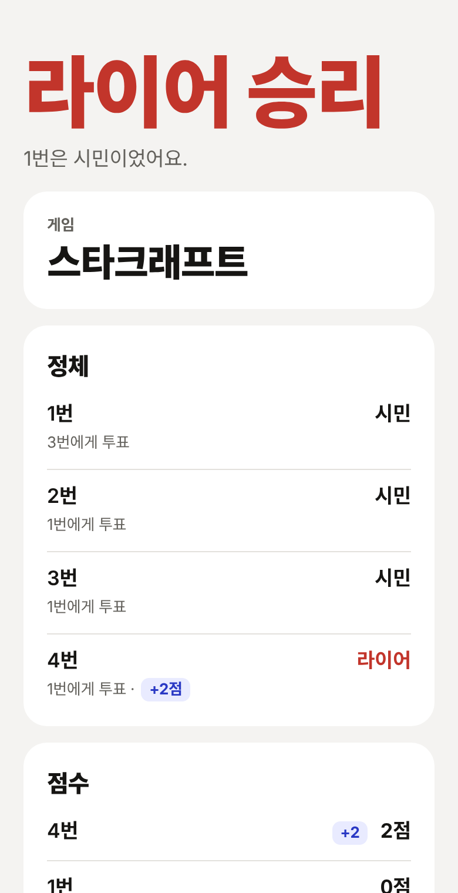

<p align="center">
  
</p>

<h3 align="center">폰 하나를 돌려가며 하는 라이어 게임</h3>

<p align="center">
  가입도 빌드도 없습니다. 열면 바로 시작하고, 홈 화면에 설치하면 오프라인에서도 됩니다.
</p>

<p align="center">
  <a href="https://hpotty36.github.io/liar-game/"><b>바로 플레이</b></a> ·
  <a href="#시작하기">시작하기</a> ·
  <a href="#한-판의-흐름">한 판의 흐름</a> ·
  <a href="#규칙">규칙</a> ·
  <a href="#개발">개발</a>
</p>

<p align="center">
  
  
  
</p>

<p align="center">
  
  
  
  
</p>

## 시작하기

폰 브라우저로 **https://hpotty36.github.io/liar-game/** 을 엽니다. 그게 전부입니다. 받아서 쓰려면 `index.html`만 열어도 됩니다.

- 인터넷이 없으면 글꼴만 기기 기본 고딕으로 바뀌고, 게임은 그대로 됩니다.
- 설정, 점수, 진행 중인 판은 그 폰의 브라우저에 저장됩니다. 화면이 꺼지거나 새로고침해도 하던 판이 이어집니다.

### 앱처럼 설치하기 (PWA)

위 주소를 홈 화면에 설치하면 앱처럼 쓸 수 있습니다. 한 번 열어 둔 뒤에는 인터넷이 없어도 열립니다.

- **아이폰**: Safari에서 열고 공유 버튼 → **홈 화면에 추가**
- **안드로이드**: Chrome에서 열고 메뉴 → **앱 설치** 또는 **홈 화면에 추가**

`manifest.webmanifest`가 앱 이름과 아이콘을, `sw.js`가 오프라인 캐시를 맡습니다. 파일을 고쳐 올리면 다음에 앱을 열 때 새 버전을 받아 두고, 그다음에 열 때 적용됩니다.

## 한 판의 흐름

1. **인원을 정합니다.** 이름은 안 적어도 됩니다. 그러면 1번, 2번으로 부릅니다.
2. **한 명씩 카드를 봅니다.** 카드는 누르고 있는 동안만 보이고, 손을 떼면 덮입니다.
3. **1번부터 돌아가며 한 문장씩 설명합니다.** 발언 타이머가 돕니다.
4. **토론하고 비밀 투표를 합니다.** 폰을 돌려가며 한 명씩 찍습니다.
5. **지목된 사람의 정체를 공개합니다.** 라이어가 잡혀도 제시어를 맞히면 역전합니다.

## 규칙

| 옵션 | 내용 |
| --- | --- |
| 기본 모드 | 라이어는 주제만 알고 제시어는 모릅니다. |
| 바보 모드 | 라이어는 다른 단어를 받고, 자기가 라이어인 줄 모릅니다. |
| 라이어 수 | 제한이 없습니다. 전원 라이어도 됩니다. |
| 스파이 수 | 제시어를 알지만 라이어 편입니다. 수에 제한이 없고, 라이어와 합쳐 인원수까지 넣을 수 있습니다. |
| 동점 | 동점인 사람끼리 재투표합니다. 또 동점이면 라이어가 이깁니다. |

점수는 이렇게 매깁니다.

| 결과 | 시민 | 라이어 | 스파이 |
| --- | :-: | :-: | :-: |
| 라이어를 잡고, 라이어가 제시어를 틀림 | +1 | | |
| 라이어를 잡았지만, 라이어가 제시어를 맞힘 | | +1 | +1 |
| 라이어를 못 잡음 | | +2 | +1 |

시민이 한 명도 없는 판은 점수를 매기지 않습니다.

## 주제

기본 주제가 48개, 주제마다 단어가 20개씩 들어 있습니다. 음식, 편의점, 술과 안주, 여행 중, 캠핑과 펜션, 학교, 회사, 군대, 연애, 게임, 초능력과 판타지 같은 것들입니다. 설정에서 **고르기**를 눌러 나올 주제를 정합니다.

**주제 직접 만들기**에서 단어 4개 이상으로 우리끼리만 아는 주제를 만들 수 있습니다.

### AI로 단어 채우기

주제 이름만 적고 **AI로 단어 채우기**를 누르면 단어 스무 개 남짓이 채워집니다. 채워진 목록은 저장하기 전에 고칠 수 있습니다.

이 버튼은 게임을 Claude 아티팩트로 열었을 때만 나옵니다. 아티팩트가 주는 `claude.use("sample")`로 Claude에게 묻기 때문입니다. `index.html`을 그냥 열면 버튼 대신 안내 문구가 보이고, 나머지 기능은 똑같이 동작합니다.

## 개발

빌드 과정이 없습니다. 마크업, 스타일, 스크립트가 모두 `index.html` 한 파일에 있고, 나머지는 설치와 오프라인을 위한 파일입니다.

```
index.html             게임 전체
manifest.webmanifest   설치용 앱 정보
sw.js                  오프라인 캐시
icons/                 앱 아이콘
tests/flow.test.js     브라우저 없이 한 판을 끝까지 돌려 보는 테스트
docs/                  README에 쓰는 이미지
```

```bash
node tests/flow.test.js
```

테스트는 가짜 DOM 위에서 아홉 가지 판을 돌립니다. 시민 승리, 역전승, 지목 실패, 두 번 연속 동점, 바보 모드, 스파이 여러 명, 시민 없는 판, 전원 라이어, 새로고침 후 이어 하기입니다. 기본 주제의 단어 수와 중복, AI로 단어 채우기, 다크 모드 스위치도 함께 확인합니다. 발언이 항상 1번부터 시작하는지, 라이어 배정이 고르게 무작위인지도 4,000판을 돌려 확인합니다.

## 디자인

따뜻한 회색 바탕에 먹색 버튼, 그리고 남색 하나만 씁니다. 남색은 게임에서 일이 벌어지는 곳에만 둡니다. 카드 뒷면, 고른 항목, 돌아가는 타이머, 최다 득표입니다.

- 글꼴은 Pretendard입니다. 불러올 수 없는 환경에서는 기기의 기본 한글 고딕으로 보입니다.
- 카드 앞면은 역할과 상관없이 똑같이 생겼습니다. 색이나 모양으로 정체가 새지 않습니다.
- 진행 화면마다 이름 하나, 숫자 하나, 버튼 하나만 둡니다. 버튼은 항상 화면 맨 아래 같은 자리에 있습니다.
- 화면이 바뀐 직후 0.35초 동안은 탭을 받지 않습니다. 이전 화면을 누르려던 손가락이 다음 화면을 누르는 일을 막습니다.
- 다크 모드는 배경이 완전한 검정입니다. 처음에는 기기 설정을 따르고, 설정 화면 오른쪽 위 스위치로 바꾸면 그 폰에 기억됩니다.

## 알려진 한계

- 직접 만든 주제는 단어가 적을수록 잡힌 라이어가 제시어를 찍어 맞히기 쉽습니다.
- AI로 단어 채우기는 Claude 아티팩트 밖에서는 쓸 수 없습니다.
- 본 카드를 다시 볼 방법이 없습니다. 남의 카드도 열 수 있게 되어서 넣지 않았습니다.
- 실제 폰 여러 대에서 손으로 누르는 동작을 충분히 확인하지 못했습니다.
